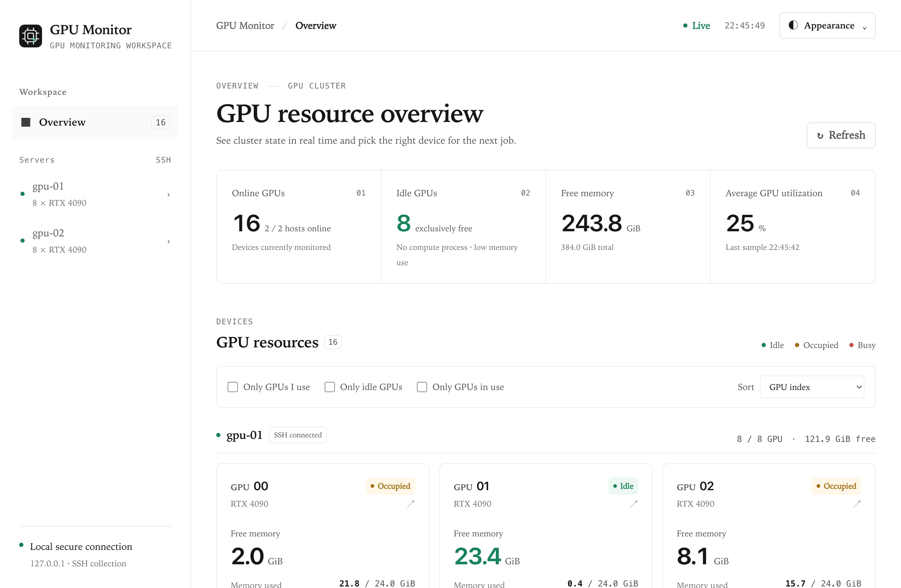

# GPU Monitor

Monitor NVIDIA GPUs across SSH servers in a local dashboard: find free GPUs,
view processes and recent utilization.
Supports Chinese / English and light / dark themes. Monitoring is read-only;
no server packages or services need to be installed.

[简体中文](README.zh-CN.md)



## Requirements

- **Local computer:** Python 3.9+ and OpenSSH. Tested on macOS; Apple Silicon
  requires Rosetta. Linux is untested; Windows is not supported.
- **GPU servers:** Linux, NVIDIA driver, `nvidia-smi` and standard `ps`.
  History sampling also requires Python 3 with `ctypes`.
- **SSH:** key authentication and server aliases in `~/.ssh/config`.
  Connect once to verify each host key and confirm that
  `ssh gpu-01 nvidia-smi` works without a password prompt.

## SSH config example

Keep connection details in OpenSSH configuration rather than putting options into
`config.json`. This preserves the dashboard's strict host-name validation while supporting
non-default ports, a jump host and private keys:

```sshconfig
Host gpu-01
  HostName 10.20.30.40
  User researcher
  Port 2201
  IdentityFile ~/.ssh/id_ed25519_lab
  ProxyJump bastion.example.edu

Host bastion.example.edu
  User researcher
  IdentityFile ~/.ssh/id_ed25519_lab
```

Connect any required VPN before starting. Then use only the alias (`gpu-01`) with
`gpu-monitor`; never place `-o`, `ProxyCommand` or a password in `config.json`.

## Quick start

Run from the repository directory:

```sh
python3 scripts/manage.py init
python3 scripts/manage.py start --open
```

`init` discovers GPU servers from your SSH config and saves them after confirmation.
To select servers explicitly, use `python3 scripts/manage.py init gpu-01 gpu-02`.
The first start downloads the GPU exporter and opens the dashboard, usually at
[127.0.0.1:8765](http://127.0.0.1:8765). Allow a few seconds for data to appear.

| Action | Command |
| --- | --- |
| Start | `python3 scripts/manage.py start --open` |
| Stop | `python3 scripts/manage.py stop` |
| Status | `python3 scripts/manage.py status` |
| Add a server | Stop, run `python3 scripts/manage.py init --add gpu-03`, then start again. |

On macOS, you can also double-click **Start.command** / **Stop.command**.
Closing the browser does not stop monitoring. Start the app again after rebooting.

For an optional command entry within an editable virtual environment:

```sh
python3 -m venv .venv
. .venv/bin/activate
python -m pip install -e .
gpu-monitor doctor
```

## Configuration and usage

Edit the generated `config.json` and restart to apply changes. Set `own_users` to
`["your-username"]` for the “mine” filter. Other settings, including the port and
collection interval, are in [config.example.json](config.example.json).
Switch language and theme in the **Appearance** menu.

“Idle” means no compute processes, at most 512 MiB used memory and at most 10%
utilization. The 30-second mean / peak and trends show recent activity; coverage
indicates sample availability. Trends reset on restart. The app does not reserve GPUs.

The dashboard shows process command lines and is intended for local access only.
Do not expose it directly to the public internet.

## Troubleshooting

Run `python3 scripts/manage.py doctor`. For connection problems, check SSH,
VPN and keys. Logs are in `.runtime/`.

## License

[MIT](LICENSE). GPU metrics use [nvidia_gpu_exporter](https://github.com/utkuozdemir/nvidia_gpu_exporter);
see [third-party notices](THIRD-PARTY-NOTICES.md).

See the [changelog](CHANGELOG.md), [citation metadata](CITATION.cff) and
[release checklist](docs/RELEASING.md) when preparing a public version.
