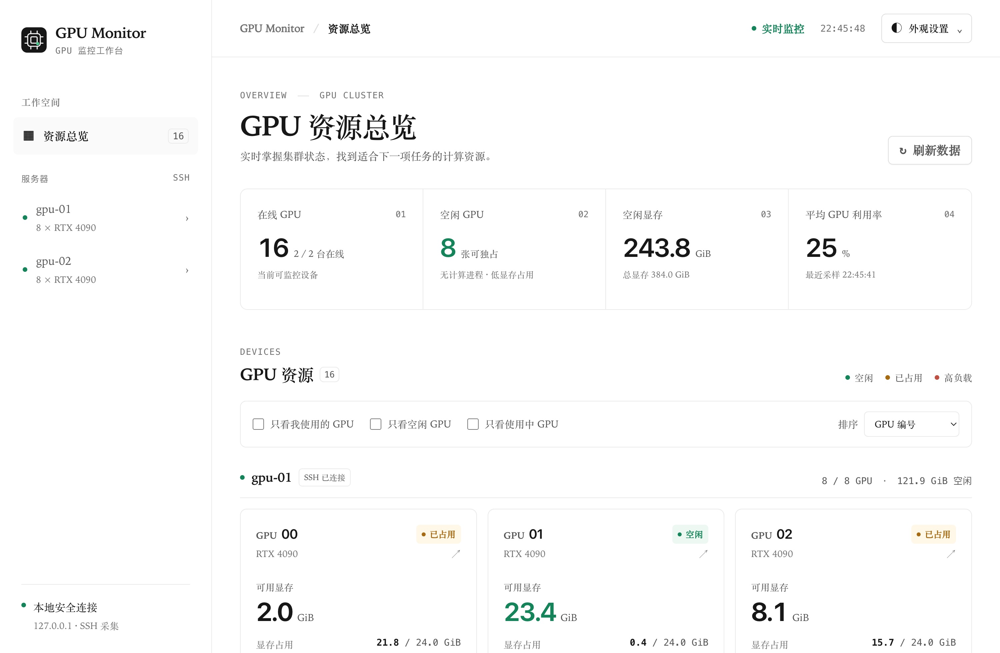

# GPU Monitor

通过 SSH，在本地网页统一查看多台服务器的 NVIDIA GPU：查找空闲卡、查看进程和近期利用率、复制 `CUDA_VISIBLE_DEVICES` 命令。支持中英文和明暗主题。监控只读，无需在服务器上安装软件包或系统服务。

[English](README.md)



## 环境要求

- **本机**：Python 3.9+、OpenSSH。macOS 已实测；Apple Silicon 需要 Rosetta。Linux 尚未实测，不支持 Windows。
- **GPU 服务器**：Linux、NVIDIA 驱动、`nvidia-smi`、标准 `ps`。历史采样还需要带有 `ctypes` 的 Python 3。
- **SSH**：使用密钥免密登录，在 `~/.ssh/config` 中配置服务器别名。先连接每台服务器一次，核验主机指纹，并确认 `ssh gpu-01 nvidia-smi` 无需输入密码即可运行。

## 快速开始

在仓库目录运行：

```sh
python3 scripts/manage.py init
python3 scripts/manage.py start --open
```

`init` 从 SSH 配置中发现 GPU 服务器，确认后保存。也可用 `python3 scripts/manage.py init gpu-01 gpu-02` 指定服务器。首次启动会自动下载 GPU 采集工具并打开网页，地址通常为 [127.0.0.1:8765](http://127.0.0.1:8765)，等待几秒即可看到数据。

| 操作 | 命令 |
| --- | --- |
| 启动 | `python3 scripts/manage.py start --open` |
| 停止 | `python3 scripts/manage.py stop` |
| 查看状态 | `python3 scripts/manage.py status` |
| 添加服务器 | 停止服务，运行 `python3 scripts/manage.py init --add gpu-03`，再启动。 |

macOS 也可双击 **Start.command** / **Stop.command** 启停。关闭网页不会停止采集；重启电脑后需要重新启动应用。

## 配置与使用

编辑初始化生成的 `config.json`，重启后生效。将 `own_users` 设为 `["你的用户名"]`，即可使用“只看我使用的 GPU”筛选。端口、采集间隔等设置见 [config.example.json](config.example.json)。语言和主题在右上角“外观设置”中切换。

“空闲”表示无计算进程、显存占用不超过 512 MiB、利用率不超过 10%。30 秒均值、峰值和趋势用于查看近期活动，覆盖率表示有效采样比例。趋势在重启后重新积累。应用不预留 GPU。

网页包含进程命令行，仅供本机访问，请勿直接暴露到公网。

## 故障排查

运行 `python3 scripts/manage.py doctor`。连接异常时先检查 SSH、VPN 和密钥，日志位于 `.runtime/`。

## 许可证

[MIT](LICENSE)。GPU 指标使用 [nvidia_gpu_exporter](https://github.com/utkuozdemir/nvidia_gpu_exporter)，第三方署名见 [THIRD-PARTY-NOTICES.md](THIRD-PARTY-NOTICES.md)。
