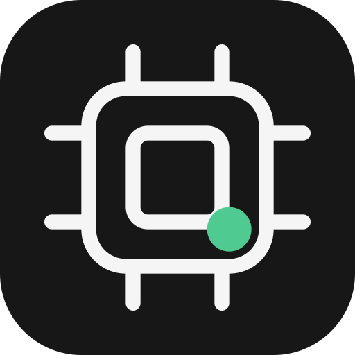

# GPU Monitor



在本地网页上实时监控所有可通过 SSH 访问的服务器的 NVIDIA GPU，一页总览，选卡只需几秒。

[English docs →](README.md)


无需 Docker、Go、Prometheus 或 Grafana。Python 部分仅使用标准库，网页为无依赖的原生 JavaScript。

## 功能

- **多服务器统一总览**，也可在左侧切换到单台服务器。
- 每张 GPU 显示已用 / 总显存、实际空闲显存、计算利用率、温度、功耗与计算进程数，并附短期趋势线。
- 可按**空闲、使用中、我使用的 GPU**（`own_users`）筛选，按编号、空闲显存或利用率排序。
- **进程表**包含服务器、物理 GPU 编号、用户、PID、GPU 显存、完整命令与运行时长，可按用户、PID 或命令搜索。
- 点击 GPU 卡片查看 UUID、驱动 / CUDA 版本、风扇、功率上限、趋势，并可复制 `CUDA_VISIBLE_DEVICES` 命令。
- **界面语言：简体中文或 English**，在“外观设置”中切换，按浏览器保存，默认简体中文。
- Light / Dark 主题；可选自备背景图。
- 各服务器独立采集，一台慢或失联不会阻塞其他服务器；超过过期窗口的旧数据会标记为过期，并排除出统计与推荐。
- 最近约 5 分钟的趋势保存在内存中，重启服务后重新积累。

## 环境要求

- **macOS**（已实测；Apple Silicon 通过 Rosetta 运行 exporter）。Linux 走同一套命令行路径通常可用，但本版本未实测；不支持 Windows。
- Python 3.9 或更高。Node.js 仅用于运行前端单元测试。
- 到每台被监控服务器的免密 SSH（密钥认证），例如 `~/.ssh/config` 中的别名。应用不会交互式询问密码。
- 被监控主机上 `nvidia-smi` 在 `PATH` 中，且 Linux `ps` 支持
  `-ww -o pid=,user:32=,pcpu=,pmem=,etimes=,args=`（标准 procps）。

对被监控主机只做只读查询：不安装任何东西、不开放远端端口、不启动任何 GPU 负载。

## 快速开始

```sh
git clone <your-repo-url> gpu-monitor && cd gpu-monitor
cp config.example.json config.json
```

编辑 `config.json`：把每个 `ssh_host` 设为 SSH 别名或 `user@host`，为每台服务器设置唯一的 `name` 与 `exporter_port`，并在 `own_users` 中填入你的 Unix 用户名以启用“只看我使用的 GPU”筛选。

然后双击 **`Start.command`**，或运行：

```sh
python3 scripts/manage.py start --open
```

随即打开 <http://127.0.0.1:8765>，首次采样需要几秒钟。双击 **`Stop.command`** 或运行 `python3 scripts/manage.py stop` 停止；`status` 查看运行状态。关闭网页不会停止后台采集。当前版本不设置开机启动，重启电脑后需再次启动。

`config.json` 保存本机特有的 SSH 别名，故意不入库；`config.example.json` 是模板。

## 配置项

| 键 | 默认值 | 含义 |
|---|---|---|
| `listen` | `127.0.0.1` | 必须保持回环地址，见“安全模型”。 |
| `port` | `8765` | 网页端口。 |
| `interval_seconds` | `3` | 每台服务器的采集间隔（≥ 1）。 |
| `collection_timeout_seconds` | `10` | 单次采集超时（1–30）。 |
| `history_points` | `100` | 每张 GPU 的内存样本数（2–1200）。 |
| `own_users` | `[]` | 视为“我的”Unix 用户名，驱动“只看我使用的 GPU”筛选。 |
| `servers[].name` | — | 唯一显示名，`[A-Za-z0-9_-]+`。 |
| `servers[].ssh_host` | — | SSH 配置别名或 `user@host`。 |
| `servers[].exporter_port` | — | 该服务器 exporter 的本地唯一端口（1024–65535）。 |

修改 `config.json` 后重启服务生效。

## 采集方式

```text
本地浏览器 127.0.0.1:8765
        ↓
Python 本地服务（快照、短期趋势、进程详情）
        ├─ 官方 exporter 127.0.0.1:19835 → ssh gpu-01 → nvidia-smi
        └─ 官方 exporter 127.0.0.1:19836 → ssh gpu-02 → nvidia-smi
```

指标来自官方 [nvidia_gpu_exporter](https://github.com/utkuozdemir/nvidia_gpu_exporter) v1.16.0 二进制，使用其支持的[远程采集方式](https://github.com/utkuozdemir/nvidia_gpu_exporter/blob/v1.16.0/docs/CONFIGURE.md#remote-scraping)：`scripts/ssh_smi.py` 作为远端 `nvidia-smi` 命令，并启用 `--collect.compute-apps`。Python 服务再通过同一 SSH 连接执行 `ps`，为每个 GPU 进程补充用户、CPU 均值、完整命令与运行时长。SSH 复用连接使用本应用专有的 `.runtime/` 控制套接字，不接管你的终端会话；密钥继续由 OpenSSH 管理，不复制到项目。

exporter 二进制在首次启动时由 `scripts/bootstrap.py` 从官方 GitHub Release 下载并做 SHA-256 校验，放入不入库的 `.tools/` 目录。详见 [THIRD-PARTY-NOTICES.md](THIRD-PARTY-NOTICES.md)。

## “空闲”的定义

仅当计算进程采集成功、计算进程数为 0、GPU 显存占用不超过 512 MiB 且利用率不超过 10% 时，才记为空闲。**利用率为 0% 但显存被 vLLM 等任务占用的卡仍显示为已占用。** 实际空闲显存直接取自驱动的 `memory.free`，不用“总量 − 已用”代替，因为还有驱动预留。提及已有任务的推荐表示“可考虑共享”，不是资源预留。

## 安全模型

- 网页与所有 exporter 仅监听 `127.0.0.1`；服务拒绝其他 `listen` 取值，并拒绝 `Host` 头不是回环地址的请求，因为页面会展示进程命令行。
- 接口只读：不提供远端命令执行、杀进程或提交任务。
- `.runtime/`（日志、PID 文件、SSH 控制套接字）以 `0700` 权限创建。
- 这是个人 / 课题组工具，请放在自己的机器后面使用，不适合不受信任的网络。

## 外观

- 主题（Light / Dark）与语言（简体中文 / English）在右上角“外观设置”中，按浏览器保存。URL 追加 `?lang=en` 或 `?theme=dark` 可强制指定，截屏时也便于控制。
- 背景图可选且永不入库：把自己的 `background-light.jpg` 与 `background-dark.jpg` 放入 `web/assets/`，不透明度滑块即会出现；没有图片时使用纯色背景。

## 故障排查

```sh
ssh -o BatchMode=yes -o ConnectTimeout=6 <ssh_host> nvidia-smi
```

失败时先解决网络 / VPN / 密钥解锁 / SSH 配置问题；应用不会交互式询问密码。新增服务器前，先在终端正常连接一次并核验主机指纹。

日志位于 `.runtime/monitor.log` 与 `.runtime/<name>-exporter.log`。启动脚本能识别本应用已运行的实例，不会重复启动，也不会停止恰好占用端口的其他程序。

没有 Rosetta 的 Apple Silicon 无法运行 x86_64 版 exporter；请安装 Rosetta 或自行提供兼容构建，`bootstrap.py` 不会修改系统组件。

## 开发与测试

```sh
python3 -m unittest discover -s tests      # 离线单元测试
node tests/test_ui_logic.cjs               # 离线前端逻辑 + 中英词典一致性测试
python3 scripts/mock_demo.py               # 合成数据预览 :8799，无需 SSH 与 GPU
python3 tests/manual/check_live.py         # 需要已启动的服务与真实 SSH 主机
python3 tests/manual/check_recovery.py     # 暂停一个本地 exporter 验证恢复，始终会恢复
```

`mock_demo.py` 用生成的数据运行真实界面，`docs/` 中的截图即由此产生。

## 限制

SSH / exec 后端无法提供每个进程的瞬时 SM 利用率，也不采集图形进程；CPU 列为 `ps` 给出的进程整个生命周期平均使用率。进程身份与命令受服务器权限限制，查不到时明确显示未知。采集与 `ps` 不是同一时刻的原子快照，进程恰好在两者之间退出时可能短暂缺少详情。长期历史、告警、资源锁定、任务排队与自动调度不属于此版本：多人仍可能同时看到同一张空闲 GPU，启动任务前请以最新状态为准。

## 许可证

MIT — 见 [LICENSE](LICENSE)。第三方组件与署名见 [THIRD-PARTY-NOTICES.md](THIRD-PARTY-NOTICES.md)。
